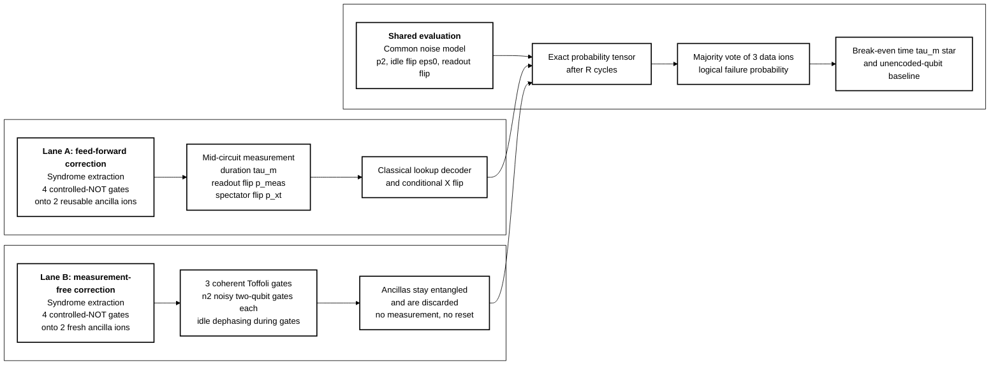
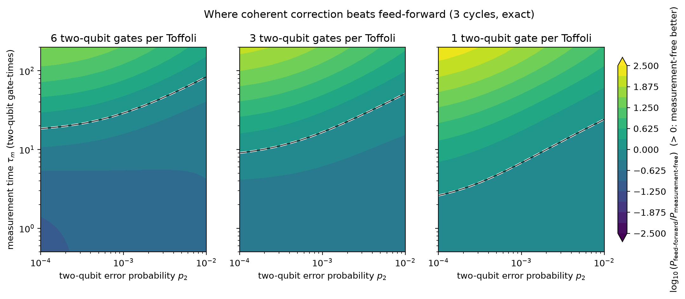
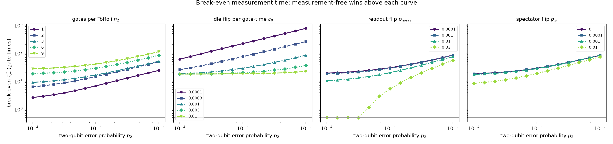
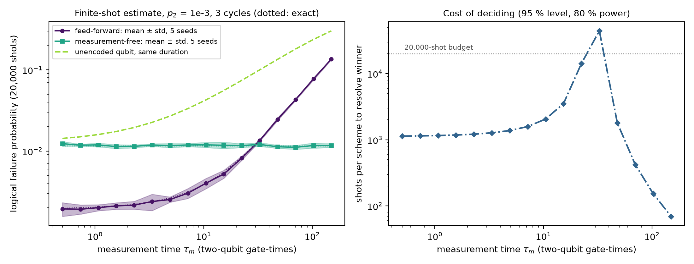
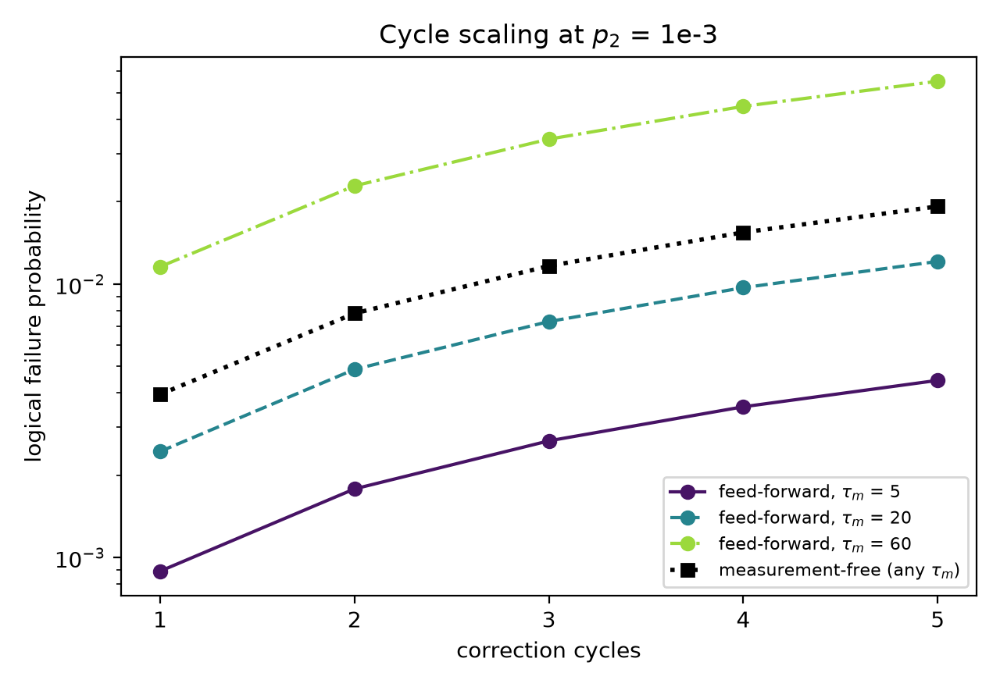
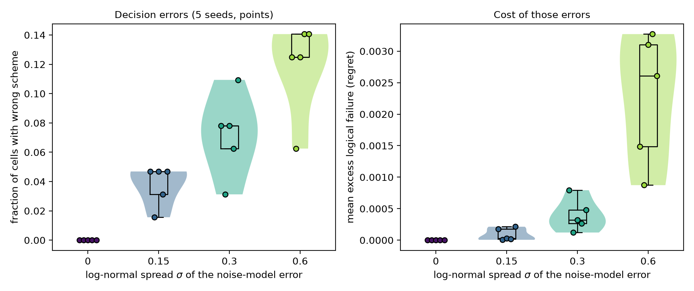

# Measurement-Free versus Feed-Forward Error Correction for a Trapped-Ion Repetition Memory


[](https://github.com/pradeepdegalaroyal/measurement-free-vs-feedforward-ion-memory/actions/workflows/ci.yml)

## Abstract

Trapped-ion experiments increasingly replace mid-circuit measurement and feed-forward with coherent, measurement-free correction, but no map exists of when this trade is favourable. We compare the two schemes on a three-ion repetition memory with exact probability-tensor simulation, sweeping two-qubit error, measurement duration, idle dephasing, readout error and Toffoli cost, and we quantify the shot budget and noise-model tolerance needed to choose between them. In simulation with illustrative parameters, measurement-free correction wins only once a measurement-plus-reset window exceeds roughly 18 to 84 two-qubit gate-times (decomposed Toffoli), it costs `2R + 3` ions instead of 5, and no quantum advantage claim is made or implied.

## Motivation

Surface-code and related landmark experiments rely on measuring syndromes mid-circuit and applying classically controlled corrections (Acharya et al., 2023; Sivak et al., 2023; Zobrist et al., 2025). On trapped ions, a 2026 experiment instead performed universal logical operations on error-detecting codes without any mid-circuit measurement, citing the slowness and error rate of measurements (Butt et al., 2026). Whether that choice pays off in a *correcting* memory depends on numbers an experimenter can estimate beforehand: how long a measurement takes relative to a two-qubit gate, how much dephasing accrues meanwhile, and how many extra noisy gates a coherent Toffoli needs. This repository answers that planning question in simulation.

## Research gap

Landmark feed-forward experiments, cited with their digital object identifiers (DOI) (Acharya et al., 2023, doi:10.1038/s41586-022-05434-1; Sivak et al., 2023, doi:10.1038/s41586-023-05782-6; Zobrist et al., 2025, doi:10.1038/s41586-024-08449-y; Bluvstein et al., 2024, doi:10.1038/s41586-023-06927-3; Iqbal et al., 2024, doi:10.1038/s41586-023-06934-4) and the measurement-free ion demonstration (Butt et al., 2026, doi:10.1038/s41467-026-68533-x) establish feasibility, and the reviews list measurement cost and error budgets as open problems (Cai et al., 2023, doi:10.1103/RevModPhys.95.045005; Matsumoto, 2027, doi:10.1007/s40314-026-03881-4). None of them maps the break-even between the two correction styles. The full related-work table (14 papers, four author-assigned roles) is in [`docs/RESEARCH_GAP.md`](docs/RESEARCH_GAP.md).

## What is new here

* An exact, parametrised break-even between measurement-free and feed-forward correction of a repetition memory, as a function of measurement time, two-qubit error, idle dephasing, readout and spectator error, and gates per Toffoli.
* The shot cost of deciding between the schemes on hardware, including the finite-shot behaviour near the break-even.
* The regret of choosing a scheme from a mis-characterised noise model (noise-characterisation error), not only the error rates themselves.
* A validated fast model: Qiskit Aer density-matrix agreement for an explicit Toffoli decomposition and an independent Monte Carlo cross-check.

## Hypotheses

Defined in [`docs/RESEARCH_GAP.md`](docs/RESEARCH_GAP.md); outcomes are given in the Results section.

| ID | Statement | Outcome |
|---|---|---|
| H1 | Break-even measurement time tau* is at most 100 two-qubit gate-times for every p2 in [1e-4, 1e-2] (decomposed Toffoli) | Supported (18.4 to 84.0) |
| H2 | tau* - 3 n2 collapses on p2 / eps0 (slope 0.8-1.2, scatter at most 0.15 decades) | Partly falsified: slope 1.08, scatter 0.27 decades |
| H3 | Readout error alone does not make measurement-free correction win at tau_m = 2 below a readout flip of 1e-2 (exact Toffoli) | Supported (threshold 2.3e-2 to 0.104) |
| H4 | At most 20,000 shots per scheme decide the winner outside +/-10 % of the break-even | Falsified: 44,298 shots needed at tau_m = 32.8 (13 % above the break-even) |
| H5 | A 0.3 log-normal noise-model error mis-classifies at most 10 % of the plane | Supported (7.2 % +/- 2.8 %) |

## Method

Three data ions store one bit; two ancillas extract two parities per cycle with four controlled-NOT (CNOT) gates. The feed-forward arm measures, resets and applies classically controlled flips; the measurement-free arm applies three coherent Toffoli gates with fresh ancillas each cycle. Both are evaluated exactly on a common noise model (details in [`docs/METHOD.md`](docs/METHOD.md)).



Legend: tau_m = measurement-plus-reset time in two-qubit gate durations; p2 = two-qubit depolarising error; n2 = two-qubit gates per Toffoli; R = number of correction cycles.

Standard quantum baseline: feed-forward syndrome measurement (as in the landmark experiments above). Classical baseline: an unencoded qubit idling for the same duration. Ablations: Toffoli cost and cycle count. Sweeps: idle, readout, spectator noise, noise-characterisation error. Seeds 0 to 4 for all stochastic parts.

## Results

Default operating point (unless stated): two-qubit error p2 = 1e-3, idle flip 1e-3 per gate-time, readout flip 1e-3, six two-qubit gates per Toffoli, three cycles. All numbers below are read from `results/`. Columns "feed-forward" and "measurement-free" are logical failure probabilities (`mb`, `mf` in the files; `mb` = measurement-based).

### Model validation (`results/validation.csv`)

The one-cycle measurement-free circuit with an explicit Hadamard/T/CNOT Toffoli decomposition in Qiskit Aer agrees with the fast model to 3.1e-16 at p2 = 1e-3, 5e-3 and 2e-2. Over three cycles with all noise sources on (p2 = 3e-3), five seeds of 1,000,000 trajectories give 0.009854 +/- 0.000091 (feed-forward, model 0.009923) and 0.026514 +/- 0.000099 (measurement-free, model 0.026503).

### Headline comparison (`results/headline.csv`, `results/summary.json`)

| Measurement time tau_m (gate-times) | Feed-forward | Measurement-free | Unencoded, feed-forward duration | Unencoded, measurement-free duration |
|---|---|---|---|---|
| 2 | 2.17e-3 | 1.16e-2 | 1.87e-2 | 6.28e-2 |
| 10 | 3.83e-3 | 1.16e-2 | 4.12e-2 | 6.28e-2 |
| 30 | 1.22e-2 | 1.16e-2 | 9.32e-2 | 6.28e-2 |
| 100 | 7.45e-2 | 1.16e-2 | 0.233 | 6.28e-2 |

Break-even at this operating point: tau* = 29.0 gate-times. Both schemes beat the unencoded qubit here; the pseudo-threshold (largest p2 at which a scheme beats the unencoded qubit, tau_m = 10) is 2.19e-2 for feed-forward and 8.08e-3 for measurement-free. Hardware cost: five ions for feed-forward, nine for measurement-free at three cycles (`results/rounds.csv`).



*Figure 1. Filled-contour phase diagrams of log10(feed-forward / measurement-free failure): measurement-free correction wins above the dashed boundary, and the region grows as the Toffoli gets cheaper (30.8 %, 40.1 % and 55.4 % of the plotted plane for 6, 3 and 1 gates per Toffoli).*

### H1 and the Toffoli-cost ablation (`results/tau_star.csv`)

For six gates per Toffoli, tau* rises from 18.4 (p2 = 1e-4) to 84.0 (p2 = 1e-2) gate-times, so H1 is supported. In the limit of small p2 the break-even approaches 3 n2 (the extra coherent-gate time): 2.6, 6.3, 9.1, 18.4 and 27.7 gate-times for n2 = 1, 2, 3, 6 and 9 at p2 = 1e-4. At p2 = 1e-3, tau* is 6.8, 14.5, 16.6, 29.0 and 40.6 for the same n2.



*Figure 2. The break-even time tau* grows with p2, with Toffoli cost, and as idle dephasing falls; readout error only matters above about 1e-2, and spectator error only at 1e-2.*

### H2: scaling collapse (`results/summary.json`)

Across five idle rates, tau* - 3 n2 follows (p2 / eps0) with log-log slope 1.08, close to linear, but the scatter about the fit is 0.27 decades (a factor of about 1.9), above the 0.15 decade criterion. The ratio p2 / eps0 alone does not determine the break-even; H2 is therefore partly falsified. For example, at p2 = 1e-3 tau* is 219.1, 75.2, 29.0, 20.0 and 18.4 for eps0 = 1e-4, 3e-4, 1e-3, 3e-3 and 1e-2.

### H3: readout error (`results/readout_threshold.csv`)

At tau_m = 2, the readout flip above which measurement-free correction wins is 1.64e-3, 6.18e-3 and 2.73e-2 for one gate per Toffoli at p2 = 1e-4, 1e-3 and 1e-2, and 2.29e-2, 3.55e-2 and 0.104 for six gates. With the exact Toffoli the thresholds exceed 1e-2, so H3 is supported: removing readout error alone is not enough; the coherent gates must also be cheap. At p_meas = 1e-3, tau* barely changes (29.0 versus 30.1 at 1e-4); spectator error at 1e-3 moves tau* from 29.0 to 28.0 at p2 = 1e-3.

### H4: shot cost (`results/finite_shot.csv`)



*Figure 3. Left: finite-shot estimates (20,000 shots, mean +/- standard deviation over five seeds) track the exact curves; right: shots per scheme needed to resolve the winner peak at the break-even.*

The shots needed to resolve the winner at 95 % level and 80 % power are 1,135 per scheme at tau_m = 0.5, 2,055 at 10.5, 14,238 at 22.4, 44,298 at 32.8 and 1,797 at 47.9, against a break-even of 29.0. The grid point 32.8 lies 13 % above the break-even, outside the +/-10 % band, and needs more than the 20,000-shot budget, so H4 is falsified as stated; the cost diverges as the two failure probabilities approach each other. Away from the crossing, 20,000 shots suffice. In all five seeds the sign of the estimated difference was correct at every grid point, including 32.8 (estimated difference 2.64e-3 +/- 1.07e-3 against exact 2.11e-3), although a 20,000-shot test is not guaranteed to reach significance there.

### Cycle scaling (`results/rounds.csv`)



*Figure 4. Logical failure grows with the number of cycles in both schemes; the measurement-free curve does not depend on the measurement time and lies between the feed-forward curves for tau_m = 20 and 60.*

At tau_m = 20 the failure after one and five cycles is 2.44e-3 and 1.21e-2 for feed-forward, and 3.95e-3 and 1.92e-2 for measurement-free. Per cycle the measurement-free memory adds about 3.8e-3, the feed-forward memory about 2.4e-3 (tau_m = 20).

### H5: noise-characterisation tolerance (`results/calibration_regret.csv`)



*Figure 5. Fraction of (p2, tau_m) cells where the wrong scheme is chosen (left) and the resulting excess failure (right), as the noise-model error grows; points are the five seeds.*

| Log-normal spread | Wrong scheme chosen | Mean regret (excess failure) |
|---|---|---|
| 0 | 0 | 0 |
| 0.15 | 3.75 % +/- 1.40 % | 8.86e-5 +/- 9.96e-5 |
| 0.3 | 7.19 % +/- 2.84 % | 3.96e-4 +/- 2.57e-4 |
| 0.6 | 11.9 % +/- 3.2 % | 2.27e-3 +/- 1.05e-3 |

H5 is supported: at spread 0.3 the wrong choice occurs in 7.2 % of cells.

## Discussion

* For the exact (six-gate) Toffoli, feed-forward correction is better in about 69 % of the plotted (p2, tau_m) plane; measurement-free correction needs a measurement-plus-reset window of tens of two-qubit gate-times to pay off. Its practical advantage is therefore conditional on slow or noisy measurements, not general.
* The break-even is controlled mainly by the extra time and gates of the coherent corrections, and secondarily by idle dephasing; it is almost independent of readout error unless readout is poor (above about 1e-2) and of spectator error unless it reaches 1e-2.
* Negative results: H2 failed its collapse criterion (0.27 decades), H4 failed just outside the stated band, because the decision is statistically expensive near the break-even, the measurement-free memory needs nine instead of five ions at three cycles, and for gate-time-limited regimes (eps0 = 1e-2) the tau* curve is nearly flat at about 18 to 22 gate-times, meaning the break-even is then set by the coherent gate count alone.
* The decision is fairly robust to characterisation error: moderate model errors (spread 0.3) cost 4.0e-4 in logical failure on average, small compared with the failure rates at the break-even (1e-2).

## Limitations

* Simulation of a three-ion bit-flip memory; only the Z-basis logical value is scored, so logical phase coherence is not assessed. A relative-phase Toffoli (three gates) is a valid choice only for this classical-bit figure of merit.
* Parameters are illustrative; they are not calibrated to IonQ Aria, IonQ Forte or any device, and gate-time ratios are free parameters.
* The Toffoli is modelled as an ideal permutation followed by pair-depolarising channels; agreement with an explicit Hadamard/T/CNOT decomposition was verified only for a single cycle with two-qubit noise (Qiskit Aer, 5 ions).
* Idle noise is applied to data ions only; ancilla idling, crosstalk between gates and correlated noise are not modelled. Errors are Pauli (no coherent errors or leakage).
* Decoding is per-cycle lookup, not a space-time decoder; larger codes are not studied.

## Future work

On trapped-ion hardware the same planning loop applies: measure the two-qubit error, the idle dephasing rate and the mid-circuit measurement time (including spectator effects) on the target machine, evaluate the break-even from the maps, and spend the shot budget in Figure 3 only where the decision is close. Next steps are a phase-coherent logical benchmark with a relative-phase Toffoli, ancilla reuse through dissipative or optical reset, error-detecting codes such as the four-qubit code with postselection, and a space-time decoder with correlated noise.

## Reproducibility

```bash
pip install -r requirements.txt
python -m pytest -q                       # 11 tests, under 5 seconds
python experiments/run_all.py --quick     # smoke run, about 40 seconds, writes to results/quick and figures/quick
python experiments/run_all.py             # full run, about 135 seconds, writes results/ and figures/
```

Hardware used: Windows 11, Python 3.11.9, 16 threads, NVIDIA RTX 5050 Laptop graphics processing unit (not used; all computation is on the central processor). Full runtime 134.8 s. Package versions are pinned in `requirements.txt` (numpy 2.2.6, pandas 2.3.3, matplotlib 3.11.1, qiskit 2.4.2, qiskit-aer 0.17.2, pytest 9.1.1). Continuous Integration runs the tests and the quick run on ubuntu-latest.

## Project structure

```
src/mfqec/noise.py        exact probability-tensor channels (bit flip, depolarising, controlled flips)
src/mfqec/schemes.py      parameters, feed-forward and measurement-free memories, baselines, costs
src/mfqec/analysis.py     break-even search, phase maps, shot statistics, characterisation-error regret
src/mfqec/validation.py   Qiskit Aer cross-check and independent trajectory sampler
src/mfqec/plots.py        viridis plotting helpers
experiments/run_all.py    one command reproducing all results and figures
tests/test_mfqec.py       unit tests
results/                  comma-separated values (CSV) and JavaScript Object Notation (JSON) outputs
figures/                  200 dpi figures
docs/                     RESEARCH_GAP.md, METHOD.md
```

## Related work by the author

* [repetition-code-breakeven-map](https://github.com/pradeepdegalaroyal/repetition-code-breakeven-map): break-even of a measurement-based repetition-code memory versus an idling qubit, with an exact space-time decoder.
* [erasure-check-period-dual-rail-repetition-memory](https://github.com/pradeepdegalaroyal/erasure-check-period-dual-rail-repetition-memory): how often a dual-rail repetition memory should run costly erasure checks.

## Citation

```bibtex
@software{degala_measurement_free_vs_feedforward_ion_memory_2026,
  author   = {Degala Chenchupradeep},
  title    = {Measurement-Free versus Feed-Forward Error Correction for a Trapped-Ion Repetition Memory},
  year     = {2026},
  version  = {0.1.0},
  url      = {https://github.com/pradeepdegalaroyal/measurement-free-vs-feedforward-ion-memory},
  license  = {MIT}
}
```

MIT license (`LICENSE`). See also `CITATION.cff`.
